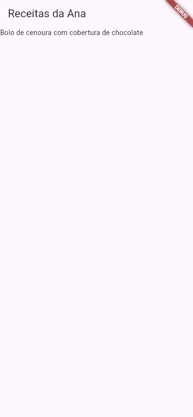

# Como escrever uma página do Guia Flutter

O guia é uma **escola**, estilo W3Schools, para quem já fez o básico de Dart (o Guia Dart: `https://wallysondevs.github.io/guia-dart/`) mas **nunca fez um app**. **Uma aula = um assunto** (um widget ou uma ideia). Nunca mostre código "seco":
- explique cada parte (anatomia: o widget, os parâmetros, o `child`/`children`);
- mostre **a tela real** que o código desenha (foto tirada de um Flutter de verdade, §5) e **a saída real** do terminal (`flutter create`, `flutter run`, erros);
- mostre **a árvore de widgets** quando ajudar (um `pre` simples com a hierarquia);
- mostre o que acontece quando dá errado: a tela vermelha/amarela, o erro de overflow, a mensagem **real** do console;
- deixe o leitor praticar no editor do guia (§4).

Antes de tudo, leia o `RECURSOS.md`.

## 0. O que o guia ensina
- **Flutter 3 (a versão estável do lab) com Material 3**, para Android em primeiro lugar; iOS, web e desktop aparecem nas aulas de build.
- Gerência de estado: `setState` primeiro; Provider/Riverpod/BLoC como visão geral no nível 3.
- O que depende de aparelho de verdade (câmera, GPS, notificações, emulador) é **ilustrativo** quando não der para conferir no lab.

## 1. Esqueleto do arquivo
Use como modelo uma aula do Guia Lua (`~/guia-lua/print.html`, na VPS): cabeçalho, `<main>`, blocos, rodapé, `.exercise`, `.mc`, `dl.anatomy`, `div.cenario`, `div.note`, `table.ref`. Troque:
- `<title>Flutter TEMA — descrição | Guia Flutter</title>`;
- `<h1>Flutter <span class="hl">TEMA</span></h1>`;
- a caixa `.trylua` por **`.tryflutter`** (§4).

Menu, selo e Anterior/Próximo vêm de `assets/site.js` (`NIVEIS`). **Não mude a `NIVEIS`.** Links internos só para páginas que estão nela.

## 2. Ordem de uma aula
1. Intro. 2. "Você vai aprender". 3. A ideia antes do código (uma comparação do dia a dia: blocos de montar, caixas dentro de caixas). 4. Do simples ao completo, uma novidade por vez, com `dl.anatomy`. 5. **A tela real** depois de cada exemplo (`figure` com a foto). 6. **Pelo menos um "Experimente"** (`.tryflutter`) por aula. 7. Formas diferentes de fazer + "qual usar". 8. **Quando dá errado** (`div.cenario`): o código errado, a tela/erro real (overflow com as listras amarelas e pretas, a tela vermelha de erro, a mensagem do console) e como resolver. 9. Referência (`table.ref`). 10. Exercícios (3 ou mais). 11. Resumo.

## 3. Componentes

### Código para ler
```html
<pre class="file" data-file="lib/main.dart">import 'package:flutter/material.dart';

void main() =&gt; runApp(const MeuApp());
</pre>
```
Escape `<`, `>` e `&` dentro de `<pre>` (`=&gt;`, `List&lt;Widget&gt;`, `&amp;&amp;`). O testador confere.

### A tela do app (`figure`)
```html
<figure class="tela"><figcaption>O app rodando (Flutter 3.x, Android em tamanho de celular).</figcaption></figure>
```
- A foto vem do **lab** (§5): o código exato do `pre.file` ao lado, compilado e fotografado. **Olhe a foto (Read) antes de escrever o `alt` e o texto que a descreve.** Em guias anteriores, autores descreveram imagens que não existiam.
- Arquivo em `assets/telas/NOME-PAGINA-N.png` (PNG otimizado; o lab já reduz). Envie a imagem com `enviar` e commite junto com a página.

### Terminal (`pre.term`)
`$ ` = `ana@notebook:~$`; `«` = anotação. Toda saída vem do lab (`flutter create`, `flutter run`, `flutter doctor`, erros do console).

### Editor "Experimente" (`.tryflutter`)
O contrato completo está na §4. O básico:
```html
<div class="tryflutter" data-goal="src:Text\('Receitas da Ana'\)">
<p class="try-task"><strong>Missão:</strong> troque o título para "Receitas da Ana".</p>
<pre class="script" data-file="main.dart">…app completo, que roda sozinho…</pre>
<pre class="solucao" data-file="main.dart">…</pre>
</div>
```
- Sempre um **app completo** num único `main.dart` (com `import` e `main`), que rode como está.
- Metas `src:REGEX` / `nsrc:REGEX` (§4.2) e a **foto** do resultado esperado (`data-foto` ou uma `figure` logo depois da caixa).

### Outros blocos
`dl.anatomy`, `div.note/.tip/.warning/.cenario`, `ol.passo`, `div.table-wrap > table.ref`, `.exercise`, `.mc`, `<span class="versao">Flutter 3.x</span>`.

## 4. O editor do guia (`assets/flutsim.js`)
> **Esta seção é mantida pelo agente do simulador.** Antes de escrever uma frase do tipo "no editor…", confira aqui.

### 4.1 O que é
- **A caixa `.tryflutter` = o editor do guia + o DartPad oficial embutido.** O leitor edita o `main.dart` num editor simples da própria página (com **▶ Rodar**, **↺ Restaurar**, **Ver solução** e **Copiar**). No 1º Rodar, a caixa abre um `iframe` do **DartPad** (`https://dartpad.dev/?embed=true&run=true&theme=light|dark`, o mesmo mecanismo da documentação oficial do Flutter) e manda o código para ele (`postMessage({type: "sourceCode", sourceCode})` depois do `{type: "ready"}` do DartPad). O DartPad compila e mostra o **app Flutter de verdade**, clicável. Os Rodar seguintes mandam o código novo para o mesmo DartPad, que roda de novo.
- **Precisa de internet e depende do Google:** o código é compilado pelos servidores do DartPad. A página **não fala com o DartPad antes do 1º Rodar** (nada é baixado ao abrir a aula). A caixa avisa isso ao leitor, e o `simulador.html` explica. Se o DartPad não disser "ready" em **30 s**, a caixa mostra: *"O DartPad não respondeu…"* e sugere **Copiar** + `dartpad.dev` ou o Flutter instalado (aula `instalar.html`).
- **Conferido no Chromium da VPS** (`tools/testar-navegador.js --dartpad N`): o DartPad responde em ~1,5 s e o app aparece em poucos segundos. A foto do resultado está em `assets/telas/simulador-1.png`; a de um erro de compilação, em `simulador-2.png`.
- **Como o DartPad aparece:** com a largura da coluna do guia (~730 px) e no celular, ele mostra **duas abas, `Code` e `Output`**, já aberto na `Output` (o app). Numa caixa bem larga (~900 px ou mais), código e app ficam lado a lado. Ele traz os próprios botões **Run** e **Reload** (recarga a quente) e a faixa **DEBUG** no canto do app.
- **Erros de compilação** aparecem **no DartPad**, em inglês: a barra de baixo com `Expected to find ','.` e `line 13, col 9`, o trecho sublinhado em vermelho, e no console a mensagem do compilador (`main.dart:13:9: Error: Expected ',' before this.`; foto: `assets/telas/simulador-2.png`). Erros em tempo de execução (overflow, exceções) aparecem no console do DartPad; antes de descrever como ficam na tela, confira com `tools/testar-navegador.js --dartpad N --fotos DIR` ou mostre a foto do lab.
- **A missão olha o código do editor do guia**, não a tela: o DartPad é outro site e a página não consegue ler o que está dentro dele (nem a cópia do código que o leitor editar lá). Diga isso quando a aula pedir para "mexer no DartPad".

### 4.2 O contrato da caixa
```html
<div class="tryflutter" data-goal="src:Text\(\s*'Receitas da Ana'\s*\)" data-foto="assets/telas/text-3.png">
<p class="try-task"><strong>Missão:</strong> troque o título para "Receitas da Ana".</p>
<pre class="script" data-file="main.dart">import 'package:flutter/material.dart';

void main() =&gt; runApp(const MeuApp());
…</pre>
<pre class="solucao" data-file="main.dart">…</pre>
</div>
```
| Parte | Regra |
|---|---|
| `pre.script` | **Exatamente um**, com `data-file="main.dart"`: um **app completo** (o `import 'package:flutter/…'` e o `void main`) que compila como está. O DartPad só tem **um arquivo**: nada de `import 'telas/…'` nem `part`. Escape `<`, `>` e `&` (`=&gt;`, `List&lt;Widget&gt;`). |
| `pre.solucao` | Obrigatório nas missões; o app completo que cumpre a missão. Também precisa compilar. |
| `data-goal` | As metas, separadas por `;;`. **`src:REGEX`** = o código do leitor casa com a regex (flag `m`; JavaScript); **`nsrc:REGEX`** = o código **não** pode casar (ex.: "tire o `const`"). Não pode ser só `nsrc:`. Os **comentários são ignorados** (`// …` e `/* … */`, fora das strings): código comentado não cumpre missão. Deixe a regex tolerante a espaços (`\s*`) e às duas aspas (`['"]`) quando fizer sentido. |
| `data-foto` (opcional) | Foto do **resultado esperado** (do lab, §5), mostrada na caixa com "Como deve ficar". Serve também para quem está sem internet. Sem `data-foto`, ponha a `figure` logo depois da caixa. |
| `data-altura` (opcional) | Altura do DartPad em px (padrão **520**). Use 600–700 em apps com listas ou formulários longos. |
| `data-erro-proposital` (opcional) | O código **inicial** não compila de propósito (a missão é consertar). O testador então exige que ele **não** compile; a solução continua tendo de compilar. |
| `p.try-task` | O texto da missão. O título "Experimente: edite o código e clique em Rodar" vem do `site.js`. |

- Caixa **sem `data-goal`** = caixa livre (só para brincar). Pelo menos **uma missão por aula** (§2).
- Na caixa: **▶ Rodar** (ou <kbd>Ctrl</kbd>+<kbd>Enter</kbd> no editor) confere a missão e roda; **✔ Missão cumprida!** quando todas as metas passam; **↺ Restaurar** volta ao código da aula; **Ver solução** → **Usar no editor**; **Copiar**; <kbd>Tab</kbd> no editor = 2 espaços.
- O que dizer ao leitor: "clique em ▶ Rodar e espere o app aparecer no DartPad, logo abaixo"; "o código é compilado pelos servidores do DartPad, do Google (precisa de internet)". **Não** diga que o Flutter roda no navegador sem internet, nem que a missão confere a tela.

### 4.3 O que funciona no DartPad e o que não
| Recurso | No DartPad |
|---|---|
| Widgets, layout, Material 3, temas, `setState`, `StatefulWidget`, navegação, animações, formulários, listas, `Future`/`async` | ✔ é o Flutter (web) de verdade, na **mesma versão do lab: Flutter 3.47.7 / Dart 3.13.5** (`stable.api.dartpad.dev/api/v3/version`, 19/10/2026; o DartPad acompanha o estável e pode passar à frente do lab) |
| Vários arquivos, `pubspec.yaml`, `assets/` (imagens locais, fontes) | **✘** um arquivo só; `Image.asset` não acha a imagem. Mostre no lab |
| Pacotes do pub.dev | só os que o DartPad traz (lista em `FlutSim.PACOTES_DARTPAD`; o testador confere): `provider`, `flutter_riverpod`/`riverpod`/`hooks_riverpod`, `flutter_bloc`/`bloc`, `go_router`, `http`, `dio`, `intl`, `shared_preferences`, `google_fonts`, `flutter_svg`, `fl_chart`, `url_launcher`, `animations`, `english_words`, `equatable`, `collection`, `rxdart`, `flame`… Fora da lista (`camera`, `sqflite`, `firebase_*`, `image_picker`, `geolocator`), só no lab (`flutter pub add`). Num pacote que mexe com o aparelho (`shared_preferences`, `url_launcher`), o comportamento é o da versão web |
| Câmera, GPS, notificações, arquivos do aparelho, `dart:io` (`File`, `Platform`) | **✘** (web). Ilustrativo ou lab |
| `flutter create/run/doctor/analyze/test`, hot reload pelo terminal | **✘** não há terminal: lab (`pre.term`) |
| `print`/`debugPrint` | aparecem no console do DartPad (a área embaixo do app, na aba Output) |

### 4.4 As ferramentas (na VPS, dentro de `~/guia-flutter`; Node 24: `. ~/.profile` antes)
- **`tools/testar-missoes.js`** (atalho do notebook: `~/guia-flutter-lab/testar pagina.html`):
  ```
  timeout 900 node tools/testar-missoes.js pagina.html [outra.html…]   (-q: só FALHA/aviso; --lints: mostra as dicas do analisador)
  timeout 3600 node tools/testar-missoes.js --todas
  timeout 300 node tools/testar-missoes.js --sem-analise pagina.html  (rápido: sem o dart analyze)
  ```
  Confere: o contrato da caixa (um `pre.script` `main.dart` com app completo, `pre.solucao` nas missões, metas conhecidas e regex válidas, `data-foto`/imagens que existem), **o código inicial NÃO cumpre e a solução cumpre** (com as mesmas funções do `flutsim.js`), **que o código compila** (o inicial, a solução e todo `pre.file` `lib/main.dart` (ou `main.dart`) com `import 'package:flutter/…'` + `void main` e só pacotes do DartPad passam pelo `dart analyze` do Flutter 3.47 da VPS num projeto modelo: `ERROR` = FALHA, `WARNING` = aviso), `<` e `&` escapados nos `pre`, links fora da NIVEIS (aviso) e dados da máquina real (FALHA). ~10 s por página.
- **`tools/testar-navegador.js`**: abre a página no Chromium da VPS, confere que as caixas montam sem erro de JS e que as missões batem; com `--dartpad N` clica em Rodar na caixa N e espera o DartPad (internet); `--codigo arq.dart` põe outro código no editor antes; `--fotos DIR` salva prints (da página e da caixa); `--largura 390` = celular; `--escuro`.
  ```
  timeout 300 node tools/testar-navegador.js --dartpad 1 --fotos /tmp/fotos pagina.html
  ```

## 5. Fidelidade: o laboratório (`~/guia-flutter-lab/`, na VPS)
Flutter estável real (versão no `COMO-USAR.md` do lab), com:
- **foto da tela**: compila um `main.dart` e devolve a foto do app em tamanho de celular (e de tablet/desktop quando a aula pedir);
- **terminal da Ana** (`ana@notebook`): `flutter create`, `flutter run` (web/servidor), `flutter doctor`, `flutter analyze`, `flutter test`, as mensagens de erro reais;
- **as mensagens do Flutter saem em inglês**: copie como saíram e explique em português;
- **Privacidade:** nada da VPS (o `flutter doctor` mostra caminhos e o sistema: só `/home/ana`, notebook; o que identificar a máquina vira ilustrativo).

## 6. Escrita
- Português do Brasil, frases curtas, "você". O leitor sabe Dart básico, nunca fez app.
- Termos em inglês ganham tradução: *widget* = "componente/peça da tela", *child* = "filho", *state* = "estado", *hot reload* = "recarga a quente".
- Exemplos com a vida da Ana: o app de receitas, a lojinha, a lista de compras.
- Boas práticas desde o começo, sempre com o porquê: `const` nos widgets que não mudam, widgets pequenos, nomes claros, `final` nos campos, Material 3 (`useMaterial3` já é o padrão).
